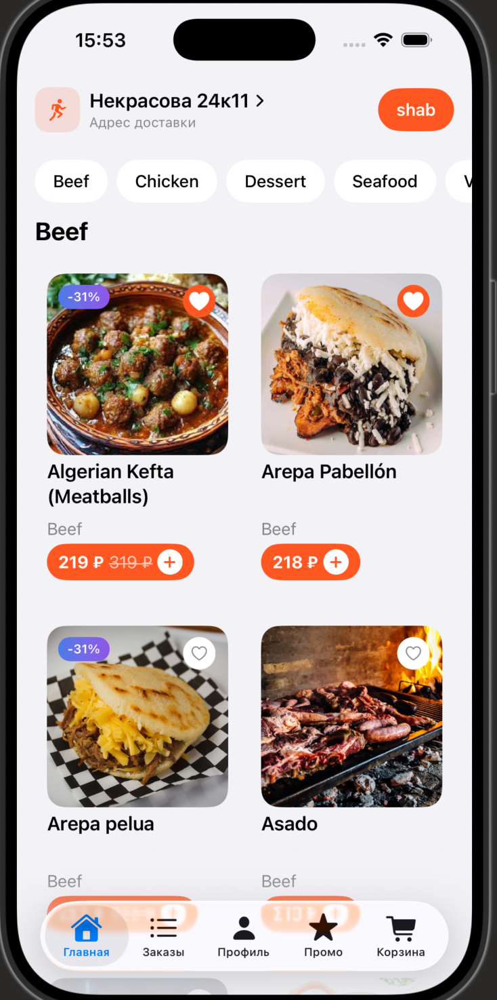
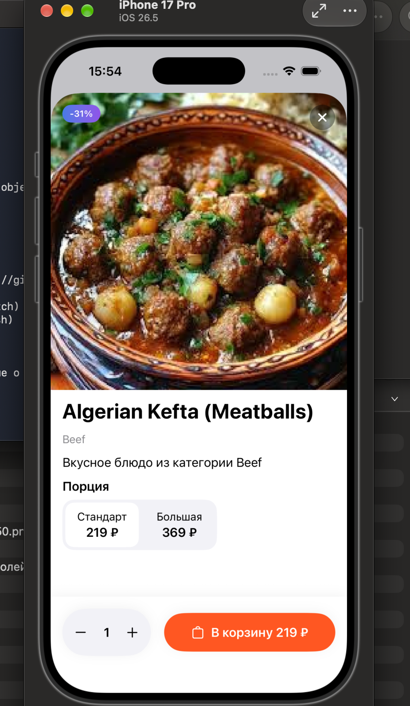
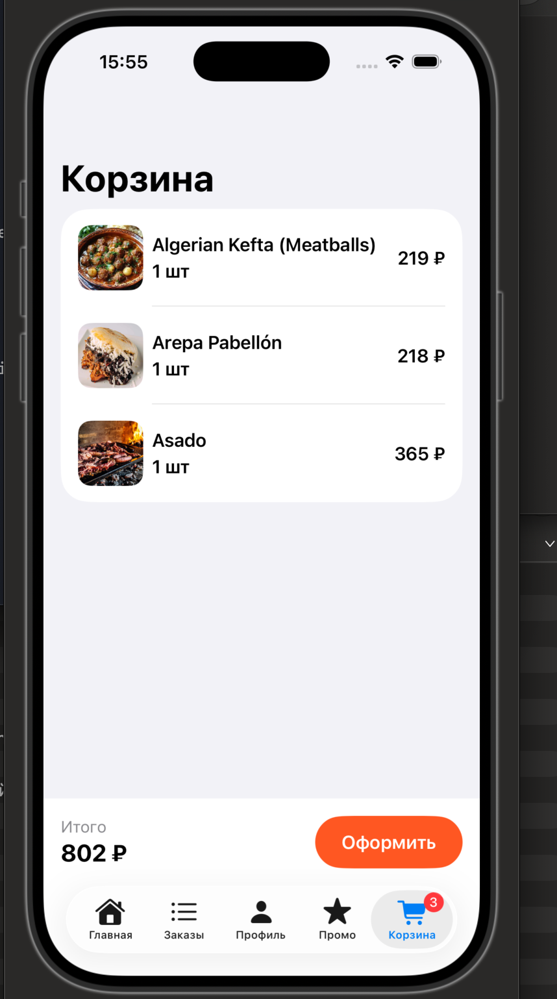
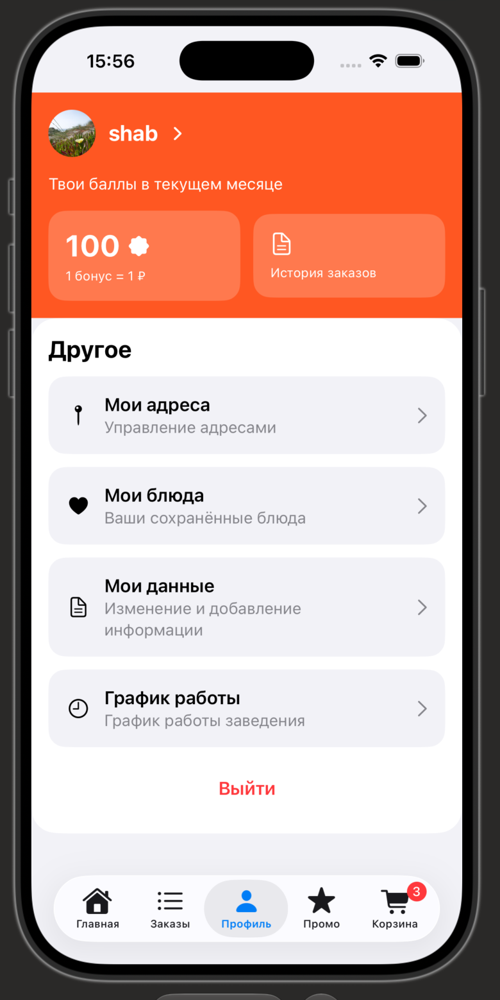

# Delee

> Учебный проект. Дизайн и название принадлежат сервису доставки Delee —
> я взяла их как образец, чтобы повторить живой интерфейс, а не рисовать
> свой. Приложение не связано с компанией и никак не используется.

Приложение доставки еды на SwiftUI. Это мой первый проект на Swift — делала его, пока училась, и почти всё здесь появилось в том порядке, в котором я разбиралась с темами.

Начинала с жёстко прописанных блюд в коде, потом подключила открытое API с рецептами и переписала модели под реальный формат ответа. Данные сохраняются на устройство, так что корзина и избранное переживают перезапуск.

## Скриншоты

| Главная | Блюдо | Корзина | Профиль |
|---|---|---|---|
|  |  |  |  |

## Что умеет

**Каталог.** Блюда приходят с TheMealDB, разбиты по категориям. Сверху чипсы — нажимаешь, список прокручивается к нужному разделу.

**Корзина и заказ.** Добавление, удаление свайпом, оформление с выбором адреса, комментарием курьеру и настройками доставки. После подтверждения — чек с деталями.

**Профиль.** Авторизация по телефону, редактирование данных, аватар из галереи, адреса с возможностью добавить и изменить.

**Избранное, промокоды, акции.** Промокод копируется нажатием и активируется через поле ввода.

Всё, что принадлежит пользователю — заказы, избранное, аватар — привязано к его телефону. Вышел, зашёл другим аккаунтом — увидишь своё.

## Стек

- Swift, SwiftUI
- `async/await` и `URLSession` для сети
- `Codable` для разбора ответов сервера и локального хранения
- `ObservableObject` + `EnvironmentObject` для состояния
- `UIViewControllerRepresentable` — обёртка над `UIImagePickerController` для выбора аватара
- Xcode 26, iOS 26

## Структура

```
Delee/
├── Components/     DishCard, ProfileRow, RadioButton, ImagePicker
├── Models/         модели данных и хранилища состояния
├── Resources/      MealAPI — сетевой слой, AppGradient
├── Views/
│   ├── Auth/       вход
│   ├── Home/       главная и категории
│   ├── Detail/     карточка блюда
│   ├── Cart/       корзина, оформление, чек
│   └── ProfileView, OrdersView, FavoritesView, AddressesView, PromoView
└── DeleeApp.swift  точка входа, подключение хранилищ
```

Модели описывают данные, хранилища держат состояние и пишут на диск, экраны только показывают.

## Чему научил этот проект

Самый долгий баг был с избранным. Сердечки слетали после перезапуска, хотя данные сохранялись правильно — я это проверила печатью в консоль. Оказалось, у блюд `id` создавался через `UUID()`, а значит при каждом запуске был новым. Сохранённые id не совпадали с текущими, и приложение просто не находило, что подсветить. Заменила на постоянный идентификатор с сервера — заработало.

Похожая история повторилась ещё трижды: заказы, аватар и избранное сначала хранились без привязки к владельцу. Вышел из аккаунта, зашёл другим — видишь чужое. Теперь у каждого свой файл, а данные не стираются при выходе, а фильтруются.

## Про данные

TheMealDB отдаёт только название, фото и категорию. Цен, скидок и опций там нет — бесплатных API с ценами не существует. Поэтому цена считается из id блюда: она случайная, но постоянная для каждого блюда и не меняется между запусками.

## Запуск

```bash
git clone https://github.com/shab0204/delee-swiftui-clone.git
cd delee-swiftui-clone
open Delee.xcodeproj
```

Дальше выбрать симулятор и нажать ⌘R. Ключи и настройки не нужны — API открытый.

## Что дальше

- Детальный экран акции
- Карта филиалов
- Свой сервер вместо локальных файлов

---

Шабнам Шарипова — [@shab0204](https://github.com/shab0204)
